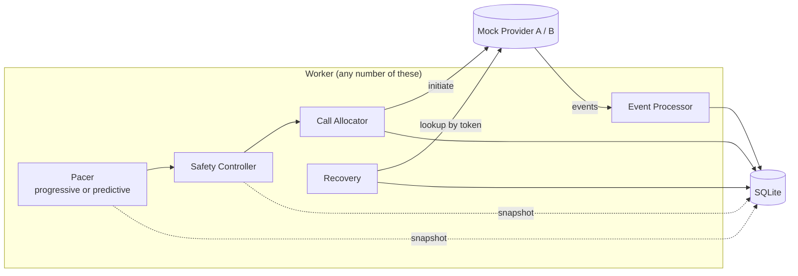
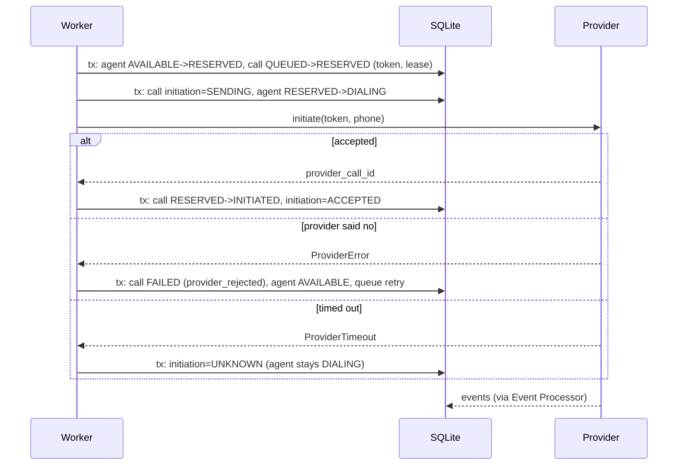

# Architecture

## Components



| Part | File | Job |
|---|---|---|
| Pacer | pacing.py | Proposes how many calls to start now and records why |
| Safety controller | safety.py | Recomputes limits from the database, approves/reduces/rejects/forces progressive |
| Allocator | allocator.py | Reserves agent + borrower, marks SENDING, calls the provider, records the result |
| Provider | providers.py | Interface plus two mocks; events come out through `poll_events()` |
| Event processor | events.py | Stores events by id, applies them to calls exactly once |
| Repository | repository.py | Every state change, always conditional on the old state |
| Recovery | recovery.py | Expired leases, ambiguous requests, stuck calls, orphan agents |
| Screening service | screening.py | For screening campaigns: reserve an agent for each borrower who said yes, transfer, end holds that run out |
| Worker | worker.py | Loop: events -> recovery -> wrap-up expiry -> one pipeline tick |

The database is the only shared state. Workers don't talk to each other and don't
cache agent or call state between ticks. Each tick reads a fresh snapshot.

## One pipeline tick

0. Screening campaigns only: `ScreeningService.run()` first gives free agents to
   borrowers already on hold (oldest first) and ends holds that ran out.
1. `take_snapshot` reads agent counts, calls in flight, recent answer outcomes,
   recent abandons and provider error rate in one read transaction.
2. The pacer turns that into a `PacingRequest` (a number, bound or unbound, and the
   reasoning).
3. The safety controller turns the request into a `SafetyDecision`. It does not use
   the pacer's estimates; it works from the same snapshot with its own rules.
4. The allocator places up to `approved` calls. Each one is reserved atomically,
   so if another worker took the last free agent in the meantime the reservation
   just comes back empty and we stop.
5. The decision, the pacer's inputs and the outcome are written to `decisions`.

## Placing one call



Why the SENDING step: database writes and the provider request can't be one atomic
operation. If we crash after the request but before recording the result, the row
says SENDING. That tells recovery the call might exist, so it must ask the provider
instead of redialing. A call stuck at NOT_SENT, on the other hand, definitely never
reached the provider and can safely go back in the queue.

The token we send with the request is echoed back in every event, so events can
find their call even if they arrive before we've written the provider's call id.

## Concurrency

Two workers, one free agent:

```sql
BEGIN IMMEDIATE;
UPDATE agents SET state = 'RESERVED', ...
 WHERE id = (SELECT id FROM agents WHERE state = 'AVAILABLE' ORDER BY updated_at, id LIMIT 1)
   AND state = 'AVAILABLE'
RETURNING id;
-- then claim a QUEUED call the same way, or ROLLBACK if there isn't one
COMMIT;
```

- `BEGIN IMMEDIATE` takes SQLite's write lock at the start. The second worker waits
  (busy timeout 10s) until the first commits.
- When it runs, the agent is no longer AVAILABLE, so its UPDATE matches nothing and
  RETURNING is empty. It moves on to the next agent or gives up.
- Even without the lock the `AND state = 'AVAILABLE'` filter means only one UPDATE
  can match. The lock just makes the select-then-update pair consistent.
- Partial unique indexes back this up at the schema level:
  `one_live_call_per_agent` and `one_live_call_per_borrower`. A bug that tried to
  double book would get an IntegrityError instead of silently succeeding.

Agent and borrower are reserved in the same transaction, so there's no state where
an agent is held with no borrower or the other way round.

Predictive (unbound) calls don't reserve an agent, so nothing row-level stops two
workers from both filling the same over-dial headroom from their own snapshots.
`reserve_unbound` therefore re-checks the cap (unbound in flight < free agents x
`max_overdial_ratio`) inside its write transaction. Six workers approving 15 calls
each against 5 free agents end up with 15 calls in total, not 90
(`test_concurrent_predictive_dialers_share_one_overdial_budget`).

Agent changes made because a call moved on (`_move_agent`) only apply if the agent
is still pointing at that call. A late event for an old call can't change an agent
that has logged off or moved to another call.

Tests: `test_many_workers_one_agent_only_one_wins`, `test_concurrent_dialers_never_overbook`,
and the load test (16 threads, 10 agents, 3000 calls, 0 double allocations).

## Events and idempotency

```
store:   INSERT OR IGNORE INTO provider_events (event_id, ...)      -- tx 1
process: check processed_at, apply to call, set processed_at          -- tx 2
```

- Same event id again: the insert is ignored and only `deliveries` goes up.
- Different id but same meaning (a second ANSWERED): the call is already CONNECTED,
  which ranks higher than ANSWERED, so it's recorded as `stale` and nothing changes.
- Anything after COMPLETED/FAILED/CANCELLED/ABANDONED is recorded as `late`.
- A late ANSWERED on a call we gave up on triggers a hangup, since a borrower may be
  on the line with nobody there.
- If the process dies between the two transactions, the event sits with
  `processed_at IS NULL` and `process_pending()` applies it later.
- If it dies inside transaction 2, the state change and `processed_at` roll back
  together. The event gets applied once on replay.

## Recovery

Recovery is a sweep any worker can run; every fix re-reads the row inside its own
transaction so overlapping sweeps don't double up.

| Situation | What recovery does |
|---|---|
| RESERVED, NOT_SENT, lease expired | Put the borrower back in the queue, free the agent |
| RESERVED, SENDING or UNKNOWN, lease expired | `provider.lookup(token)`: found -> adopt as INITIATED; not found -> FAILED `not_placed` (retryable); provider down -> leave it and keep the agent held |
| Still ambiguous after `ambiguous_give_up_s` | FAILED `unreconciled`, agent freed. If the call shows up later its events land on a terminal call and an ANSWERED is hung up |
| Live call with no event for `stuck_call_s` | Ask the provider and replay its status through the normal event path |
| Agent busy but its call is finished | Free the agent |
| Worker heartbeat stale | Mark it DEAD (informational; leases do the real work) |

The lease (30s) is deliberately longer than the provider request timeout (5s);
`Settings.validate()` refuses a config where it isn't. So by the time a lease expires,
the worker that held it has either finished its request or is gone.

## Provider outage

- Requests time out: each timed-out call keeps its agent held until reconciled, so a
  dead provider naturally stops eating capacity. Once enough requests in the last
  minute have failed, the safety controller rejects all new calls
  (`provider_unhealthy`). Live calls carry on, and their events still arrive.
- Provider fully down: requests are refused (definite failure, safe to retry later)
  and webhooks back up. The breaker trips after the first batch fails.
- Retries: a failed borrower goes back in the queue with `not_before = now + 60s` and
  counts against `max_attempts`. Ambiguous calls are never retried until
  reconciliation says the provider doesn't have them.
- Pacing: the predictive pacer also scales its request down by provider health. As old
  failures age out of the one-minute window, the safety controller allows only a
  couple of probe calls while the recent error rate is still high, and goes back to
  normal once those succeed.

## Screening campaigns

A screening campaign places bot calls instead of agent calls (mock bot, see
[screening.md](screening.md)). No agent is reserved when dialing. Borrowers who tell
the bot they're willing go to TRANSFER_PENDING, and the screening service reserves an
agent for them with the same conditional-update pattern used everywhere else, then asks
the provider to transfer using a token. Pacing, safety and recovery all have a
screening branch:

- Pacer: progressive keeps bot calls in flight plus people on hold at or below free
  agents; predictive uses the binomial risk model on the willing rate.
- Safety: no new bot calls while anyone is waiting for an agent (`transfer_backlog`);
  progressive cap or `max_screening_ratio` x free agents; bot concurrency cap; falls
  back to progressive on cold start or if more than 5% of recent willing borrowers
  weren't served. `review_transfer` refuses any transfer without a "willing" result.
- Reservation: `reserve_screening` re-checks the capacity cap under the write lock.
- Recovery: transfers stuck in SENDING/UNKNOWN are looked up at the provider, then
  adopted, resent with the same token, or replayed. The agent is never freed or
  swapped on a guess.

## Agent availability drop

Pacing reads agent counts from the database on every tick (once a second in the
simulator), so the first decision after 40 agents log off already uses the new
number. Agents logging off mid-call are handled in `set_agent_state`: an undialed
reservation goes back in the queue, a ringing call is cancelled and retried later,
and a request in flight is detached and has to find another agent if answered.
