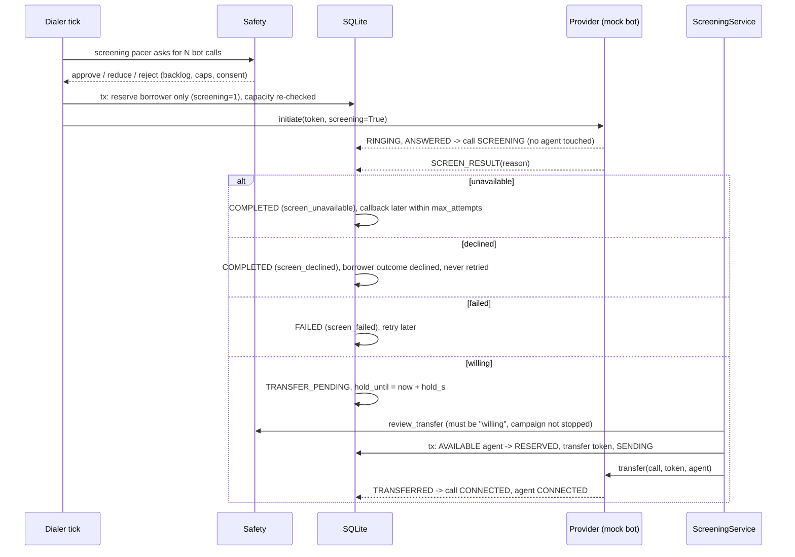

# Screening bot -> agent transfer (mock screening prototype)

The idea: a voice bot calls the borrower first, checks whether they can talk now and
want to speak to someone, and only then hands them to a human agent. People who don't
pick up, are busy, can't talk or say no never take up an agent's time.

**This is a mock screening prototype, not a working voice bot.** There's no speech
recognition, text-to-speech or language model in this repository, and no real
telephony. The mock provider decides each conversation's outcome from configured
probabilities. Everything around it (reservations, transfers, consent, retries,
recovery, reporting) is real code and is what a real voice provider would plug into.

## Screening is not predictive dialing

| | Predictive dialing | Screening |
|---|---|---|
| Question it answers | How many calls should we start right now? | Should this particular person go to an agent at all? |
| When it acts | Before dialing | After the borrower picks up, before an agent joins |
| What it uses | Answer rate, free agents, calls in flight | The bot's conversation with the borrower |
| Risk it creates | More answers than agents (abandoned calls) | A willing borrower on hold with nobody free |

They're independent. A screening campaign can pace its bot calls progressively (never
more bot calls in flight than free agents) or predictively (sized on the measured
willing rate). Both go through the same safety controller.

## Flow



Call states added for this: SCREENING (bot is talking) and TRANSFER_PENDING (borrower
said yes; on hold until an agent is reserved and the provider bridges them). See
[state-machines.md](state-machines.md).

## How the mock conversation works

`MockProvider._screen()` in providers.py. When a screening call is answered it waits
`bot_s` seconds (default 15 to 40) and then reports one of:

| Outcome | Default share in the `screening` preset | What the provider sends |
|---|---|---|
| failed | 3% | FAILED, reason `screen_failed` |
| willing | 35% | SCREEN_RESULT `willing`, borrower holds; hangs up after `hold_patience_s` (60s) if nobody takes them |
| unavailable | 25% | SCREEN_RESULT `unavailable`, then COMPLETED (bot hangs up) |
| declined | the rest (37%) | SCREEN_RESULT `declined`, then COMPLETED |

No answer and busy come from the normal ring logic, before the bot is involved.
`transfer(call, token, agent)` only works on a call that's holding, and the same token
twice is a no-op.

## Reserving an agent safely

`ScreeningService.run()` runs at the start of every dialer tick, before any new bot
calls are paced, so people already waiting get agents first (oldest first).

`Repository.claim_transfer_agent()` does it in one transaction:

```sql
UPDATE agents SET state = 'RESERVED', current_call_id = :call
 WHERE id = (SELECT id FROM agents WHERE state = 'AVAILABLE' ORDER BY updated_at, id LIMIT 1)
   AND state = 'AVAILABLE'
RETURNING id;
UPDATE calls SET agent_id = :agent, transfer_token = :token, transfer_status = 'SENDING', ...
 WHERE id = :call AND state = 'TRANSFER_PENDING' AND agent_id IS NULL;
```

Same pattern as every other reservation: `BEGIN IMMEDIATE`, conditional on the old
state, and the partial unique index `one_live_call_per_agent` now covers
TRANSFER_PENDING, so the database itself refuses one agent on two transfers. Six
threads racing to transfer ten waiting borrowers with three agents end up with exactly
three transfers, to three different agents (`test_concurrent_transfers_compete_for_limited_agents`).

Only after that commits does the service call `provider.transfer()`. Nothing is held
open across the provider call.

## Nobody free

The borrower is never told they're connected unless the provider confirms the transfer
(TRANSFERRED event). While they wait the call stays TRANSFER_PENDING with no agent. If
no agent frees up within `hold_s` (20s by default), the service ends the call politely
(provider hangup; a real bot would say "we'll call you back") and records FAILED with
reason `no_agent_transfer`. Then `no_agent_policy` decides:

- `callback` (default): queue another attempt after `callback_delay_s` (300s), within
  `max_attempts`.
- `end`: stop; borrower outcome `no_agent_transfer`.

If the borrower hangs up first, the reason is `caller_left_hold` and it's treated like
a callback.

New bot calls are blocked while anyone is waiting (`transfer_backlog`), and predictive
screening falls back to progressive if more than 5% of recent willing borrowers didn't
reach an agent (`transfer_fail_rate`).

## Consent

- A transfer needs `screen_result = 'willing'`. `SafetyController.review_transfer()`
  checks this before every transfer, and `check_invariants()` flags any call that
  reached an agent without it.
- A declined borrower gets outcome `declined` and is never retried. If the "declined"
  result arrives late (after the call ended), it's still recorded, and any queued retry
  for that borrower is cancelled.
- A stopped campaign ends pending transfers (`transfer_blocked`); a paused one still
  finishes transfers for people who already said yes, but starts no new calls.
- Retries for unavailable, failed and no-agent outcomes are limited by `max_attempts`
  (3) and spaced by their own delays.

This is not legal compliance. A production system needs recorded consent to be called,
opt-out handling across campaigns, calling-hour rules, recording disclosures, privacy
safeguards and a legal/regulatory review for each market.

## Duplicates, ordering, crashes, timeouts

| Situation | Result |
|---|---|
| Same SCREEN_RESULT event id twice | second is `duplicate`, nothing changes |
| Second "willing" with a new id | `stale` (call is already TRANSFER_PENDING or further), no second agent claim |
| Same or repeated TRANSFERRED | `duplicate` / `stale`, agent stays as is |
| SCREEN_RESULT before ANSWERED | the answer is implied; ANSWERED arriving later is stale |
| COMPLETED before TRANSFERRED, transfer already sent | counted as connected then completed; agent goes to wrap-up |
| COMPLETED while on hold with no agent | `caller_left_hold` |
| Worker crashes during screening | events keep arriving and any worker processes them; if they're lost, recovery asks the provider and replays its status |
| Crash after the transfer was accepted | recovery sees SENDING after the lease, looks the call up: provider says transferred -> adopt and replay TRANSFERRED; no second transfer |
| Crash before the transfer was sent | recovery finds the borrower still holding and resends with the same token |
| Transfer times out | status UNKNOWN, agent stays reserved (the borrower may already be talking to them); recovery reconciles after the lease |
| Provider rejects the transfer | agent released, borrower keeps holding and can get the next free agent |

## Running it

From `backend/` with the venv active:

```powershell
python -m smartdialx.main simulate --mode progressive --screening
python -m smartdialx.main simulate --mode predictive --screening --timeline
python -m smartdialx.main simulate --scenario screening --mode predictive
python -m smartdialx.main simulate --mode predictive --screening --willing-rate 0.5 --hold 30
python -m smartdialx.main compare-screening
python -m smartdialx.main demo
```

`--screening` without `--willing-rate` uses the screening population above.

## Measured results

From `compare-screening` (seed 7, 20 agents, 120s talk, 30 minutes). Both sides call
the same population: 35% of people who answer want to talk, the rest don't. Without
screening, the ones who don't want to talk still reach an agent for a short (about 20s)
call. "Productive" counts only agent time spent with someone who wanted to talk.

```
answer         mode  screening  initiated  agent_convs  productive   util  productive_util  abandoned  willing_not_served
   20%  progressive         no       1006          199          83  32.5%            25.2%          0                   0
   20%   predictive         no       1704          325         132  52.4%            39.5%          1                   0
   20%  progressive        yes        963           76          76  24.2%            22.3%          0                   0
   20%   predictive        yes       2647          177         177  57.5%            54.4%          0                   0
   50%  progressive         no        750          365         132  55.4%            41.2%          0                   0
   50%   predictive         no        849          413         156  63.9%            47.2%          0                   0
   50%  progressive        yes        680          121         121  40.1%            38.4%          0                   0
   50%   predictive        yes       1190          198         198  61.4%            59.4%          0                   3
```

What this does and doesn't show:

- Predictive pacing with screening had the highest productive utilization in both
  answer-rate settings: 54.4% vs 39.5% for plain predictive at 20%, 59.4% vs 47.2% at
  50%. Agents stop spending time on people who were never going to talk.
- Progressive with screening is worse than plain progressive (22.3% vs 25.2% at 20%).
  It only allows as many bot calls as there are free agents, and the bot conversation
  adds 15 to 40 seconds before the hand-off, so agents wait longer. Screening pays off
  when it's combined with pacing that dials ahead.
- Screening isn't free for the borrower: 3 willing people in the 50% predictive run
  weren't served within the 20s hold and got a callback instead.
- These are mock numbers. The gain depends entirely on the willing rate, how long a
  real "not interested" call takes an agent, and how long a real bot conversation
  takes. None of that has been measured with real calls. Treat this as evidence the
  mechanism works, not as a forecast.

## Implemented vs future work

Implemented: screening campaigns, SCREENING/TRANSFER_PENDING states, mock bot outcomes,
atomic agent reservation for transfers, transfer protocol with tokens, hold timeout
with callback or end policy, consent gate, backlog and transfer-failure safety rules,
progressive and predictive screening pacers, recovery for screening and transfers,
separate reporting, demos, 30 screening tests plus simulation and worker-thread tests.

Not implemented: any real speech or language processing, a real voice-bot provider
(Plivo, Twilio, etc.), a real "please hold" message, recording and consent capture,
warm transfer with context passed to the agent's screen, cross-campaign do-not-call
lists, calling-hour rules.
