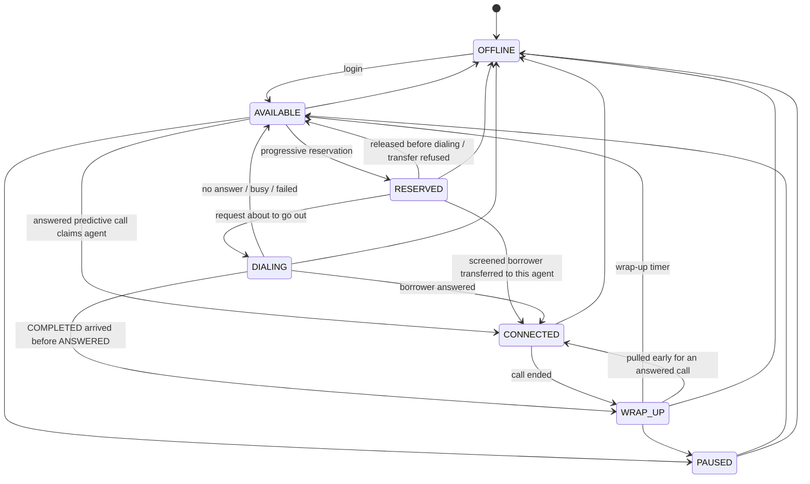
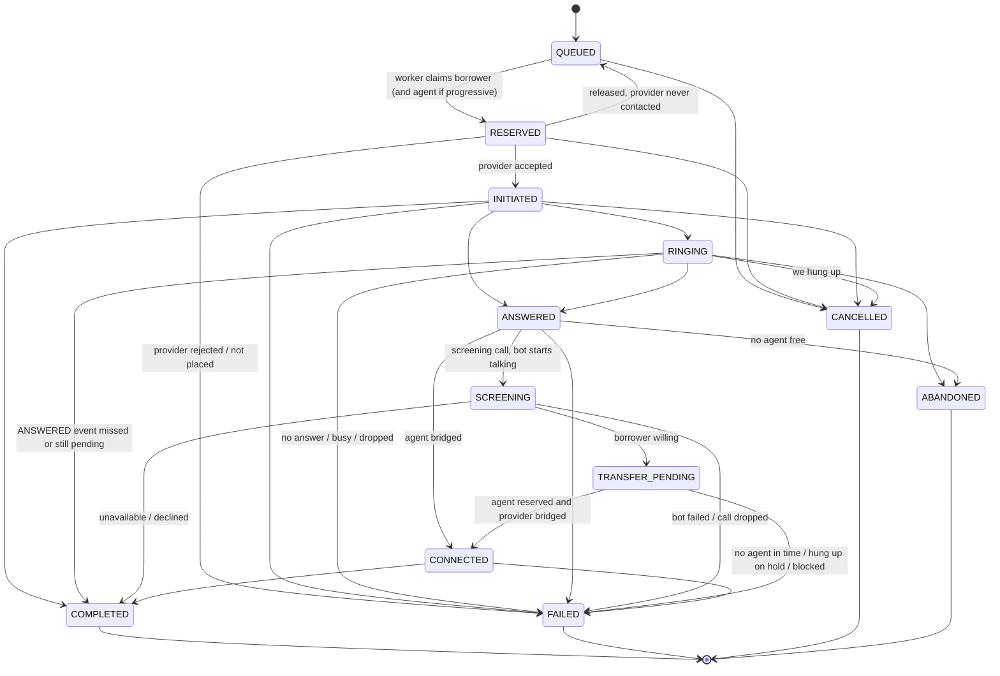

# State machines

Both tables live in `state_machine.py`. The repository checks them before every
change, and every UPDATE also filters on the state it expects to leave, so a
transition decided on stale data simply doesn't match any row.

## Agent



Notes:
- OFFLINE is reachable from anywhere because agents really do disconnect whenever
  they like. What happens to their call depends on how far it got (see below).
- PAUSED is not allowed from RESERVED or DIALING. An agent who's being dialed for
  has to finish or log off.
- CONNECTED -> AVAILABLE is not allowed; calls always end in WRAP_UP.
- `agents.current_call_id` points at the call the agent is working on. Changes caused
  by a call only apply while that pointer still matches, which is what stops a late
  event for an old call from moving an agent who has moved on.

When an agent goes OFFLINE mid-call:

| Call state | Result |
|---|---|
| RESERVED, request not sent | Call goes back to QUEUED, nothing was dialed |
| RESERVED, request SENDING/UNKNOWN | Call is detached from the agent and continues as unbound; if answered it needs another free agent or it's abandoned |
| INITIATED / RINGING | Call CANCELLED (`agent_left`), provider hangup, borrower retried later |
| ANSWERED | Call ABANDONED, hangup |
| TRANSFER_PENDING (agent held for a screened borrower) | Call FAILED (`agent_left`), hangup, callback later |
| CONNECTED | Call FAILED (`agent_left`), hangup |

An agent is RESERVED in two situations: progressive calls (held before dialing) and
screening transfers (held for a borrower who said yes, until the provider bridges them).
An agent is never held while a screening bot is talking.

## Call



Terminal: COMPLETED, FAILED, CANCELLED, ABANDONED. Nothing leaves them.

### ANSWERED vs CONNECTED

- ANSWERED means the provider told us the borrower picked up.
- CONNECTED means we bridged them to an agent.

For a progressive call the agent is already reserved, so ANSWERED becomes CONNECTED
in the same transaction. For a predictive call there's no agent yet: on ANSWERED we
try to claim a free agent (or one with a few seconds of wrap-up left). If there's
nobody, the call becomes ABANDONED and we hang up. ANSWERED never survives past the
transaction that processed it; it's the point where that decision gets made.

### SCREENING and TRANSFER_PENDING (screening campaigns only)

- SCREENING: the borrower answered and the screening bot is talking to them. No agent
  is involved.
- TRANSFER_PENDING: the bot recorded them as willing. They're on hold. The call either
  has no agent yet (waiting, at most `hold_s`) or has one reserved with a transfer in
  progress. It becomes CONNECTED only when the provider confirms the transfer.

The screening outcomes end up as different end reasons, never ABANDONED:

| Outcome | State | End reason | Next |
|---|---|---|---|
| no answer / busy | FAILED | `no_answer` / `busy` | retry within `max_attempts` |
| can't talk now | COMPLETED | `screen_unavailable` | callback after `unavailable_retry_s` |
| doesn't want an agent | COMPLETED | `screen_declined` | never called again |
| bot failed | FAILED | `screen_failed` | retry |
| willing, nobody free in time | FAILED | `no_agent_transfer` | callback or stop (`no_agent_policy`) |
| willing, hung up while holding | FAILED | `caller_left_hold` | callback |
| willing, transferred | CONNECTED -> COMPLETED | `completed` | done |

ABANDONED keeps its original meaning: a predictive call answered by a borrower who then
heard nobody. A screening borrower always has the bot on the line, so they are never
abandoned in that sense.

### ABANDONED

Not in the assignment's list, but it's the number that matters most for compliance,
so it gets its own terminal state instead of being hidden inside FAILED with a
reason code. Abandoned borrowers are not automatically retried.

### Other details

- QUEUED rows are created per attempt. A retry is a new row with `attempt + 1` and
  `not_before` set to the retry delay. A partial unique index allows at most one
  non-terminal row per borrower.
- `initiation` tracks the provider request separately from the call state:
  NOT_SENT -> SENDING -> ACCEPTED, or REJECTED, or UNKNOWN (timed out). That's how
  recovery tells "safe to requeue" from "must ask the provider first".

## Provider events

| Event | Target state |
|---|---|
| INITIATED | INITIATED |
| RINGING | RINGING |
| ANSWERED | ANSWERED, then CONNECTED or ABANDONED |
| COMPLETED | COMPLETED (ABANDONED if the borrower was never bridged to anyone) |
| NO_ANSWER, BUSY, FAILED, TIMED_OUT | FAILED with that reason |
| CANCELLED | CANCELLED |
| SCREEN_RESULT (screening only) | willing: TRANSFER_PENDING; unavailable/declined: COMPLETED; failed: FAILED |
| TRANSFERRED (screening only) | CONNECTED |

For screening calls ANSWERED goes to SCREENING instead of CONNECTED. A SCREEN_RESULT
or TRANSFERRED that arrives before ANSWERED implies it, so the call is moved through
ANSWERED and SCREENING first. A late "declined" on a finished call is still recorded
and stops any further calls to that borrower.

How each event is classified (`state_machine.classify`):

| Case | Example | Verdict | Effect |
|---|---|---|---|
| Call already terminal | ANSWERED after COMPLETED | late | recorded, nothing changes (hangup if ANSWERED on a call we gave up on) |
| Target ranks at or below current | RINGING after ANSWERED, second ANSWERED | stale | recorded, `last_event_at` touched |
| Allowed transition | RINGING -> ANSWERED, INITIATED -> COMPLETED | applied | state changes, agent updated |
| Anything else | CANCELLED while CONNECTED | invalid | recorded with both states, nothing changes |
| Same event id again | any | duplicate | `deliveries` counter goes up |

Rank: QUEUED 0, RESERVED 1, INITIATED 2, RINGING 3, ANSWERED 4, SCREENING 5,
TRANSFER_PENDING 6, CONNECTED 7, terminal 9.
Skipping forward is allowed (INITIATED -> COMPLETED) because providers don't always
send every step and some steps arrive late.

The two sequences from the assignment, as the tests and `main.py demo` show them:

```
ANSWERED, ANSWERED, ANSWERED, COMPLETED
  same id three times -> applied, duplicate, duplicate   (call CONNECTED)
  new ids             -> stale, stale
  COMPLETED           -> applied                          (call COMPLETED, agent WRAP_UP)

COMPLETED, ANSWERED, RINGING
  COMPLETED -> applied (INITIATED -> COMPLETED, agent WRAP_UP)
  ANSWERED  -> late
  RINGING   -> late
```

Worker crashes right after ANSWERED is stored, then COMPLETED arrives: COMPLETED is
applied (RINGING/INITIATED -> COMPLETED, agent to WRAP_UP). When the stored ANSWERED is
finally processed it's late and changes nothing.
